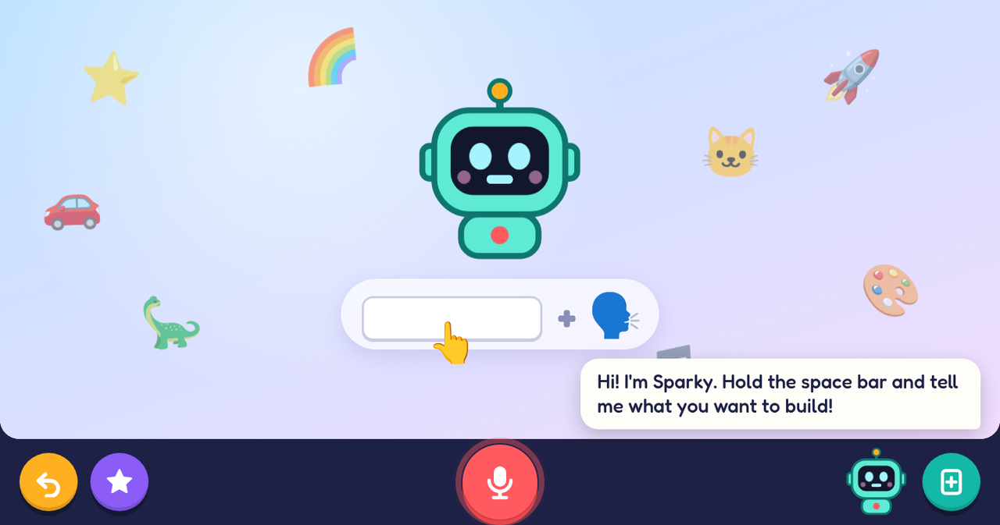
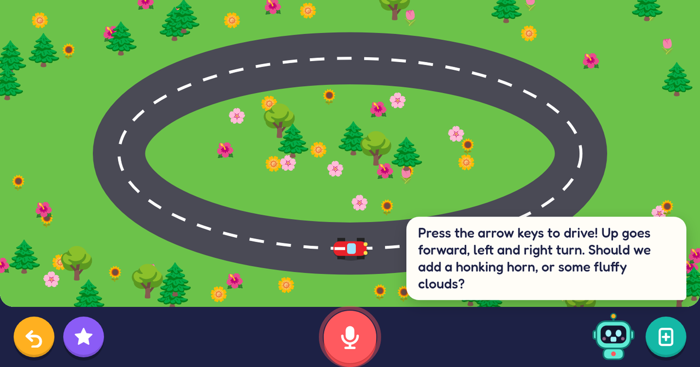
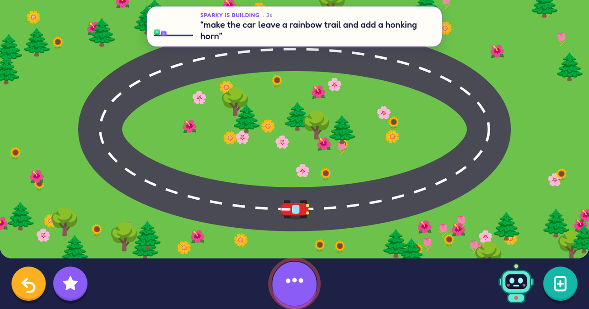
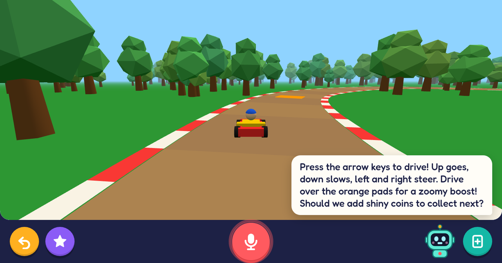

# 🤖 Build Buddy

**A full-screen, voice-first "build anything with AI" playground for young kids.**

  

The screen starts empty except for a friendly robot named Sparky. Your kid holds the **space bar**,
says what they want ("a red car I can drive around!"), and a few seconds later it's on the screen,
playable. Then they keep going: *"make it blue"*, *"add a honking horn"*, *"now make it 3D"*. That loop
of describing an idea, seeing it, and making it better is the skill Build Buddy teaches: how to build
things with AI.

It runs on your own computer and uses the **Claude or ChatGPT subscription you already have**. Your
kid's voice is understood and spoken on the computer itself, so their voice never leaves it.

| Hold space and talk | Sparky builds it |
|---|---|
|  |  |
| **Keep improving it** (the old version stays playable while the new one builds) | **Real 3D games, at full frame rate** |
|  |  |

---

## Contents

- [What a session looks like](#what-a-session-looks-like)
- [Install](#install)
- [Run it](#run-it)
- [Using it](#using-it)
- [Settings](#settings)
- [How it works](#how-it-works)
- [Safety and privacy](#safety-and-privacy)
- [Troubleshooting](#troubleshooting)
- [Project layout](#project-layout)
- [Credits](#credits)
- [License](#license)

## What a session looks like

1. **They hold space and talk.** *"I want a rocket ship that flies to the moon!"*
2. **Sparky answers out loud** within a couple of seconds, showing what it understood:
   *"A rocket ship zooming to the moon? Blast off!"* A small card at the top shows it's building.
3. **It appears** with a ta-da sound, and Sparky explains how to play: *"Click anywhere to blast off!"*
4. **The next idea is theirs.** Sparky never suggests what to add. At most it asks *"What's next?"*,
   so they learn to come up with ideas and put them into words, instead of just saying yes or no.
5. **They keep building, without starting over.** Changes take a few seconds and slot into the
   game they're playing: their score and where they were come back. If they don't like something,
   the back button undoes it.
6. **A careful helper keeps watch.** Once they've played for a bit, a stronger AI looks at the game
   and quietly fixes it if it's broken or stuck.

## Install

You need:

- **Node.js 20 or newer** ([nodejs.org](https://nodejs.org))
- **Google Chrome, Chromium, Edge or Brave**
- **At least one AI "brain"**, signed in once:
  - **Claude:** install [Claude Code](https://claude.com/claude-code), then run `claude` once and sign in with your Claude account.
  - **ChatGPT:** install Codex (`npm install -g @openai/codex`), then run `codex login` with your ChatGPT account.
- To build the speech recognizer: `git`, `cmake` and a C++ compiler (on a Mac, `brew install whisper-cpp` instead).
  Optional: `WHISPER_GPU=1 ./setup.sh` also builds the GPU version (on Linux it needs Vulkan drivers
  and `glslc`) and fetches the larger speech model; see `whisper.gpu` below.

Then:

```bash
git clone https://github.com/F286/build-buddy.git
cd build-buddy
./setup.sh
```

`setup.sh` puts everything in `./vendor`, about 1.2 GB, and installs nothing system-wide. Running it again is safe. It sets up:

| | What it is | Size |
|---|---|---|
| whisper.cpp + `small.en` | Speech-to-text (Sparky's ears) | ~500 MB |
| Parakeet TDT 0.6B v2 | A second speech recognizer, listening alongside whisper | ~660 MB |
| Kokoro (via sherpa-onnx) | Natural-sounding voice (Sparky's voice) | ~460 MB |
| Piper | Faster, more robotic backup voice | ~110 MB |
| Phaser | 2D game engine creations can use | ~1.4 MB |
| Three.js | 3D engine creations can use | ~17 MB |

## Run it

```bash
./start.sh                  # full screen; close the window to quit
./start.sh --window         # in a normal window, for grown-ups trying it out
./start.sh --no-browser     # just the server; open http://127.0.0.1:4321 yourself
./start.sh --window --debug # also lets Chrome DevTools tools attach on port 9222
./start.sh --classic        # one AI writes each creation by itself, instead of a team (see Team mode)
```

**Grown-up controls:** press **Ctrl+Shift+P** for settings (time limit, AI brain, how Claude builds, voice, names), the
current creation's frame rate, and the **Quit** button. Press **Enter** to type a request instead of
talking.

**Time limit:** pick one at the top of the Ctrl+Shift+P panel (2 to 60 minutes) and press Save; the
countdown starts then. For the last minute a clock counts down in the corner and Sparky says *"One
more minute!"*. When it runs out, the game is put away and a *"Time's up!"* screen stays until a
grown-up opens the panel again and adds time or picks *No limit*. Their progress in the game is
kept for when it comes back. If time runs out while they're still asking for something (still
talking, or Sparky is still building), nothing gets cut off: Sparky finishes it, and they get one
more minute to play with it, but can't ask for anything new.
Time spent fixing a wobbly bit (a creation that crashed) isn't counted. The limit is off unless a grown-up turns it on here; kids can't set
it by asking Sparky. Closing and reopening the app doesn't get around it, but if the app is started
half an hour or more after the time ran out, it starts with no limit.

**Add it to your app launcher (Linux):** run `./install-launcher.sh`, then find *Build Buddy* in your
launcher. On Omarchy, press Super+Space and type `build`. If it's already open, the launcher jumps to
the open window instead of starting a second copy. If a copy is still running without its window,
starting Build Buddy again closes that copy and opens a fresh one. `./install-launcher.sh --remove`
takes it out again.

**Start it when the computer logs in:** on Omarchy/Hyprland, add
`o.launch_on_start("/path/to/build-buddy/start.sh")` to `~/.config/hypr/autostart.lua`. On other
Linux desktops, add a `start.sh` entry to your startup applications. On macOS, add it under Login Items.

## Using it

| On screen | What it does |
|---|---|
| 🎤 big red button, or the **space bar** | Hold and talk, walkie-talkie style. Or tap once: it stops listening when they pause. Listening starts half a second *before* the key goes down and carries on for a moment after it's let go, so first and last words aren't clipped. |
| ↩️ yellow | Go back one step. Every version is kept, so nothing is ever lost. |
| ⭐ purple | *My creations*: everything they've made, by emoji and name. Hidden until a grown-up turns it on in the Ctrl+Shift+P panel. |
| ➕ teal | A fresh new page. The old one stays in *My creations*. |
| 🤖 Sparky | Says what it understood straight away, then how to play. It never suggests ideas; those come from the kid. |

Things to try: *a piano with rainbow keys*, *a fish tank where I can feed the fish*, *a dinosaur
that dances when I click it*, *a 3D racing game*, *make it faster*, *add a second player*, *make the
sky night time*. Sparky is told to keep everything friendly. Monsters come out goofy and zaps turn
into confetti.

## Settings

Put your settings in `config.json` (start from [`config.example.json`](config.example.json)). Anything
you leave out uses the defaults in [`server/config.mjs`](server/config.mjs). The AI brain, models,
voice and names can also be changed from the Ctrl+Shift+P panel.

| Setting | Default | What it does |
|---|---|---|
| `kidName` | `""` | Sparky greets them by name. |
| `kidAge` | `5` | Sparky pitches words and games to this age. |
| `buddyName` | `"Sparky"` | The robot's name. |
| `backends` | `["claude", "codex"]` | Which AI to use, in order. If the first fails (offline, usage limit), the next takes over. |
| `claude.model` / `claude.effort` | `"opus"` / `"low"` | Model and effort for Claude Code. Opus makes richer, more varied creations; `"sonnet"` is a little faster for big new ones. |
| `claude.fast` | `false` | Claude's [fast mode](https://code.claude.com/docs/en/fast-mode) for building: the same model, answering much sooner. On a Claude subscription it's paid from extra usage credits; with none left it quietly runs at normal speed, and the Ctrl+Shift+P panel says why. Also in the panel as *Claude speed*. |
| `team.enabled` | `true` | [Team mode](#team-mode): a lead and a team of Claude helpers build each creation together. `false` is the classic way: one AI writes it all. Also in the panel as *How Claude builds*, and for one run with `./start.sh --classic` (or `--team`). Needs `claude` first in `backends`. |
| `team.helpers` | `6` | The most helpers working on one creation at a time (1 to 8). |
| `team.leads` | `3` | How many leads start on each request at once (1 to 3). How long a lead takes before it starts writing varies a lot, so the first one to start a plan is used and the others stop: it saves the slow starts, for a little more of your plan. |
| `team.lead` / `team.helper` / `team.fixer` / `team.checker` / `team.polisher` / `team.voice` / `team.sketch` | see [Team mode](#team-mode) | How each member of the team runs Claude Code: `model`, `effort`, `fast`, `advisor` and `args`. |
| `team.firstLook` | `true` | For something new, a quick sketch of it is on screen within seconds, and the kid can play with it until the team's version replaces it. |
| `team.check` | `true` | Right after a creation appears, the checker takes a careful look and its fixes slide in at a calm moment. |
| `team.polish` | `2` | After the check, how many times the polisher gives it finishing touches (`false` for none). Each pass costs no waiting: the creation is already on screen, and the touches slide in like the check's fixes. |
| `team.warm` | `true` | Start the team's programs while the kid is still talking, so none of them has to start up once the request arrives. |
| `whisper.model` / `whisper.gpu` | `"small.en"` / `false` | Speech model, and whether it may use the GPU. `{ "model": "large-v3-turbo-q5_0", "gpu": true }` makes about a quarter fewer mistakes with little kids (after `WHISPER_GPU=1 ./setup.sh`), but games stutter for a moment after each request while it uses the GPU. |
| `codex.model` / `codex.reasoning` | Codex default / `"low"` | Model and reasoning effort for Codex. |
| `command.cmd` / `command.args` | | Any program that reads a prompt on stdin and prints a reply, e.g. `"ollama"`, `["run", "qwen3"]`. Use it with `"backends": ["command"]`. |
| `stt` | `"both"` | Speech-to-text: `both` (whisper and Parakeet together, the AI gets both versions), `whisper`, `parakeet`, or `browser` (Chrome's online speech service; macOS/Windows Chrome only). |
| `tts` | `"kokoro"` | Voice: `kokoro` (natural), `piper` (faster), `browser` (the system's voices), or `off`. |
| `kokoro.voice` / `kokoro.speed` | `"af_heart"` / `1.0` | One of 28 English voices; preview them in the Ctrl+Shift+P panel. |
| `watch.enabled` | `true` | The overwatch: a stronger AI that checks on the game while they play and fixes it if it's broken or stuck. |
| `watch.model` / `watch.effort` | `"opus"` / `"medium"` | Model and effort for the overwatch (with Claude; with Codex it uses high reasoning). |
| `watch.firstAfterSec` / `watch.everySec` | `25` / `180` | First check after this much play, then this often while they keep playing the same version. |
| `creationsButton` | `false` | Show the ⭐ *My creations* button, so the kid can go back to anything they've made. Also in the Ctrl+Shift+P panel. |
| `unmuteMic` | `true` | Linux: switch the microphone on at startup if it's muted in the system settings. |
| `keepOpen` | `false` | Kid-proof mode: reopen the window if it's closed. Quit with Ctrl+Shift+P instead. |
| `port` | `4321` | Local port for the app. |
| `browser` | auto | Path to the browser, if it isn't found automatically. |

### Team mode

Team mode is how Build Buddy builds by default. In the classic way, one AI writes the whole page
from top to bottom, and the kid waits for every line of it. In team mode, Claude Code works as a
team, and each member is its own `claude` run:

| Role | Default | What it does |
|---|---|---|
| `voice` | `haiku`, low effort | Answers out loud straight away (in about 2 s), while the others build. |
| `sketch` | `sonnet`, low effort | For something new, makes a quick first look at it (`team.firstLook`): the thing they asked for, big and moving, in a simple scene, answering the keys and taps. It's on screen as soon as a lead starts its plan, and the team's version replaces it. It's never saved, and never shown for a change to what's already there. |
| `lead` | your `claude.model` / `claude.effort` | Three race (`team.leads`); the first to start a plan is used. Plans the page: the code every piece shares, one job per helper (each starting with exactly what it defines, like `makeWorld(scene) → { update(dt) }`), and the code that puts the pieces together. Small changes it makes itself, as edits. |
| `helper` | `sonnet`, low effort | Each writes one piece, all at the same time (Sonnet writes about 40% faster than Opus, and with the lead's detailed plan its pieces judged as well). A helper starts the moment its job is written, while the lead is still writing the rest. One that hasn't written a word after 7 s is thinking hard, so a second helper takes the same job and whichever finishes first is used. |
| `fixer` | your `claude.model` / `claude.effort` | Before anything is shown, every script on the page is checked (two pieces that declared the same name are untangled automatically); if one doesn't parse, or if edits don't fit, the fixer gets one try to repair it. If edits still don't fit, the classic way builds that request instead (so nothing the kid made goes missing); if a script still doesn't parse, the usual wobbly-bit fixing takes over. A new creation that replaces a first look is also run out of sight for a moment first; if it crashes, the fixer repairs it while the kid keeps playing with the first look, so a crashing page is never shown. |
| `checker` | your `claude.model`, medium effort | Right after the creation appears, takes a careful look at the whole page and at a screenshot of it running (with its frame rate and any errors): is everything the kid asked for really there, do new goals or levels come soon, do the pieces fit, do the controls work with both the keys and the pointer, is everything in view and nothing cut off or in the way, can the goal really be reached, is it smooth (below about 30 frames per second it finds what makes each frame heavy and lightens it). Where an arrow key or a tap does nothing it adds a small answer (a wiggle, or sparkles where they tapped), and where reaching the goal has no celebration it adds one. Its fixes (usually about half a minute later) are first tried out of sight for a moment (a fix that throws errors is taken back, so a creation that works is never broken by its polish), then slide in at a calm moment, keeping the kid's progress, so the kid never waits for it. |
| `polisher` | your `claude.model`, high effort | After the check, looks at it again as a demanding parent who is also a game designer and makes the two or three changes that matter most: the look they were given really showing, the star recognizable, in proportion and with a visible face, a goal that needs the kid, every action answered, nothing cut off or harsh. Twice by default (`team.polish`); tried out of sight and slid in like the check's fixes. |

A creation then takes about as long as its biggest piece, instead of the whole page, and each
helper puts its full attention on one thing. If the team gets stuck, that request is built the
classic way instead.

Every role takes the same options, so you can tune how Claude Code runs:

```json
"team": {
  "enabled": true,
  "helpers": 6,
  "lead":   { "model": "opus", "effort": "low", "fast": true },
  "helper": { "model": "sonnet", "effort": "low", "advisor": "opus" },
  "voice":  { "model": "haiku" },
  "fixer":  { "model": "opus", "args": ["--fallback-model", "sonnet"] }
}
```

- `model` / `effort`: any Claude Code model alias or name, and `low` to `max`.
- `fast`: [fast mode](https://code.claude.com/docs/en/fast-mode) for that role (paid from extra
  usage credits on a subscription). Fast mode for just the lead is the cheapest big speed-up: it
  writes the plan, which every helper waits for.
- `advisor`: a stronger model the role can ask for advice before it writes (Claude Code's advisor
  tool; it must be at least as capable as the role's own model, e.g. `opus` advising `sonnet`).
  Each consultation adds a few seconds.
- `args`: any other `claude` command-line options for that role.

A team build uses more of your plan than a classic one (several AIs read the request, and the pages
come out bigger and more detailed), and runs up to `helpers` + 2 `claude` programs at once.

**API keys instead of subscriptions:** the `claude` and `codex` CLIs accept API keys too
(`ANTHROPIC_API_KEY`, or `printenv OPENAI_API_KEY | codex login --with-api-key`). Nothing in Build
Buddy changes.

## How it works

```
 kid talks ──► whisper.cpp ──► Claude Code or Codex CLI ──► web page on the stage ──► Kokoro voice
 (space bar)   (on device)      (your subscription)           (sandboxed iframe)       (on device)
```

- **Each creation is one web page** (HTML, CSS and JavaScript). That's the format AI models write
  most fluently, and it covers what kids ask for: drawings, animations, games, music, toys and
  stories. Two game engines ship with the app: [Phaser](https://phaser.io) for 2D games (physics,
  particles, tweens, so things bounce and sparkle instead of sitting still) and
  [Three.js](https://threejs.org) for 3D. Both run on the GPU. Without a 3D engine, the AI hand-draws
  "3D" on a 2D canvas: a test kart game ran at 7 fps that way, and at 120 fps with Three.js.
- **Changes don't restart the game.** Each creation keeps the kid's progress (score, level,
  position, things collected) in a small `KB.keep({...})` object. When a new version arrives, those
  values are handed over, but only where they still fit (same kind of value), so a changed game
  can't be pushed into a state it doesn't understand. If the new version still crashes with them,
  it quietly starts fresh instead.
- **Your subscription is the brain.** Build Buddy runs the official `claude` or `codex` command-line
  tools in non-interactive mode on your computer, so each request counts against your plan's normal
  usage, just as if you'd typed it yourself. It doesn't extract or reuse login tokens.
- **Fast feedback.** With Claude, the AI's first sentence is spoken while the rest is still being written.
  Small changes come back as find-and-replace edits instead of a whole new page, and Sparky speaks
  sentence by sentence, preparing the next one while the current one plays.
- **Built for little voices.** Two speech recognizers listen at once, both on the computer:
  whisper (`small.en`) and NVIDIA's Parakeet. They get *different* words wrong, so Sparky is given
  both versions and works out what was meant. In one test whisper heard "a Cunado", Parakeet heard "a
  panado", and Sparky built the tornado that was asked for. On toddler-style test speech, picking the
  better of the two each time cut mistakes by about a fifth. Both together take about 2 s. They run on
  the CPU on purpose: on the GPU, speech recognition makes games stutter while it works. Whisper is
  also told what the kid is building and what they said lately; silence is never sent to either, so
  they can't invent sentences; and rude words that a mumble gets misheard as are masked. Listening
  starts half a second before the talk key goes down and keeps going a moment after it's let go.
- **Built by a team.** In [team mode](#team-mode) (the default), a quick model answers out loud
  within about 2 seconds, and for anything new a quick first look at it is on screen within about
  14 seconds, ready to play with, while three leads race to plan the creation and up to six
  helpers write its pieces at the same time, each starting the moment its job is written. Before
  anything is shown, every script is checked, something new is run out of sight for a moment,
  and a fixer repairs what doesn't run; right after it
  appears, a checker and then a polisher (twice) look over the whole page and at a screenshot of it
  running, and give it fixes and finishing touches (in tests: a piano key that crashed, food the
  fish could never reach, a frog that caught flies on its own, a car too big for its road, a
  dragon without real wings). Their changes are tried out of sight first, so they can never break
  a creation that works, and slide in while the kid plays. On a test set of eight new creations
  and four changes (timed like at home), a first look was on screen after about 14 s, and the full
  creation after about 27 s on average instead of 45 s, never later than 34 s instead of 72 s;
  Sparky's first words came after about 2 s instead of 9 s, and changes took 20 s instead of 26 s.
  In blind side-by-side judging against the classic way, the team's creations won 11 of 12; scored
  one at a time against fixed anchors (10 = nothing noticeably wrong), they averaged 7.8 out of 10
  against the classic way's 6.5 - as high as Opus at high effort with no time limit (7.9, taking 1.5
  to 3 minutes per creation, with the same check and polish). It writes about twice as much, so it
  uses more of your plan.
- **It fixes its own mistakes.** If a creation crashes, Sparky says *"Oops! Let me fix a wobbly bit"*
  and asks the AI to fix it, at most twice in a row.
- **An overwatch looks after it, quietly.** After the kid has played a version for 25 seconds, and
  every 3 minutes after that while they keep playing it, Opus takes a careful look: a screenshot of
  the game, its frame rate, recent errors and kept values. It fixes problems that don't show up as
  errors, like a player who's invisible or stuck, a frozen screen, or a request that didn't take.
  If everything works, it may give that version one tiny polish (something cut off at the edge, too
  small to see, a missing bounce), but it never adds new things or changes what the kid chose, so
  it's still entirely their creation. Usually it leaves things alone. Its changes slide in at a calm
  moment without losing progress (fixes with a soft sparkle, polish silently). If the quick fixes
  fail, it's called in straight away. The Ctrl+Shift+P panel shows its last verdict, and
  `data/log.txt` has a `WATCH` line for every check.
- **No two creations look the same.** Each new creation is nudged toward a different look (cartoon
  outlines, paper cut-out, glowing night, pixel art, picture book, and so on), with a full scene
  behind it, characters with personality, and a small hidden surprise or two to discover. What to
  build is always the kid's idea; Sparky never suggests one.
- **Smooth by default.** The AI follows a short performance checklist, and creations render at no
  more than 1.5× pixel density, so sharp screens don't quadruple the work.

## Safety and privacy

- **Hard to break.** In full-screen mode there's no address bar, tabs or menus. With
  `"keepOpen": true` the window also reopens if it's closed, so only Ctrl+Shift+P → Quit stops it. Space and Enter always belong to the app, even while a game has focus.
  Every version is saved, so a restart picks up where they left off.
- **Creations are sandboxed.** They can't reach the internet, open windows, navigate away, store
  anything, or touch the rest of the app. The only things they can load are the bundled Phaser and
  Three.js.
- **What leaves your computer:** the text of each request and the current creation's code, sent to
  Claude or ChatGPT. The overwatch (and in team mode the checker) also sends a small screenshot of
  the creation itself, drawn from inside it (never the camera or the rest of the screen). Listening and speaking happen on the computer itself.
- **What's kept:** creations, conversations and a log live in `data/` on your computer.
  `data/log.txt` shows every request: what was heard, which AI answered, and how long it took.
- **Kid-friendly by instruction.** Sparky is told to keep everything friendly and age-appropriate,
  but it's still an AI. Sit with them the first few times.

## Troubleshooting

| Problem | What to check |
|---|---|
| **Sparky can't hear** | Usually the microphone is muted in the system settings, so the app receives silence. On Linux the app switches it on at startup; if it gets muted mid-session, Sparky says *"My ears are turned off!"* Each recording is logged in `data/log.txt` as a `HEAR` line with its length, loudness and what was understood. |
| **No voice** | Check the system volume, and the *Talking* line in the Ctrl+Shift+P panel. If Kokoro isn't installed, Sparky falls back to Piper. |
| **"My brain got a little tangled"** | The AI request failed. Check `data/log.txt`. Common causes are being offline, a usage limit, or needing to sign in to `claude` / `codex` again. |
| **A game feels slow** | Ctrl+Shift+P shows its frame rate. Asking Sparky to *"make it simpler"* or *"make it faster"* helps. For 2D games Sparky should be using Phaser, and for 3D, Three.js. |
| **"Port 4321 is busy"** | Build Buddy is already running, or set a different `port` in `config.json`. |

**Platforms:** developed on Linux (Arch Linux ARM on Apple Silicon, Hyprland, Chromium). macOS
should work the same way with Chrome. On Windows the app itself runs (Node finds Chrome or Edge),
but `setup.sh` needs WSL, or use `"stt": "browser", "tts": "browser"` with Chrome.

## Project layout

```
server/main.mjs      web server, API, full-screen browser launcher
server/ai.mjs        Sparky's instructions, AI backends (claude / codex / command), reply parsing
server/team.mjs      team mode: a lead and helpers that build a creation together, at the same time
server/speech.mjs    whisper.cpp (listening), Kokoro and Piper (talking)
server/watch.mjs     the overwatch: a stronger model that checks on games and fixes them
server/store.mjs     creations and their versions, saved in data/projects/
server/config.mjs    settings and their defaults
public/              the kid-facing screen
public/stage-shim.js runs inside every creation: crash reports, talk keys, KB.keep, overwatch reports
setup.sh             downloads and builds everything in vendor/
start.sh             starts the app
install-launcher.sh  adds Build Buddy to your Linux app launcher
```

No dependencies to `npm install`. The server uses only Node's standard library.

## Credits

Build Buddy stands on these projects (downloaded by `setup.sh`, not included in this repository):

- [whisper.cpp](https://github.com/ggml-org/whisper.cpp), speech-to-text (MIT)
- [Parakeet TDT 0.6B v2](https://huggingface.co/nvidia/parakeet-tdt-0.6b-v2) by NVIDIA, second speech recognizer (CC BY 4.0), run with sherpa-onnx
- [Kokoro-82M](https://huggingface.co/hexgrad/Kokoro-82M), natural voice (Apache 2.0), run with [sherpa-onnx](https://github.com/k2-fsa/sherpa-onnx) (Apache 2.0)
- [Piper](https://github.com/rhasspy/piper), backup voice (MIT); each voice model has its own license
- [Phaser](https://phaser.io), 2D game engine (MIT)
- [Three.js](https://threejs.org), 3D engine (MIT)
- [Fredoka](https://fonts.google.com/specimen/Fredoka), the rounded font (SIL Open Font License, included in `public/fonts`)

## License

[MIT](LICENSE): free to use, copy, change and share, for any purpose. The projects listed under
[Credits](#credits) keep their own licenses.
